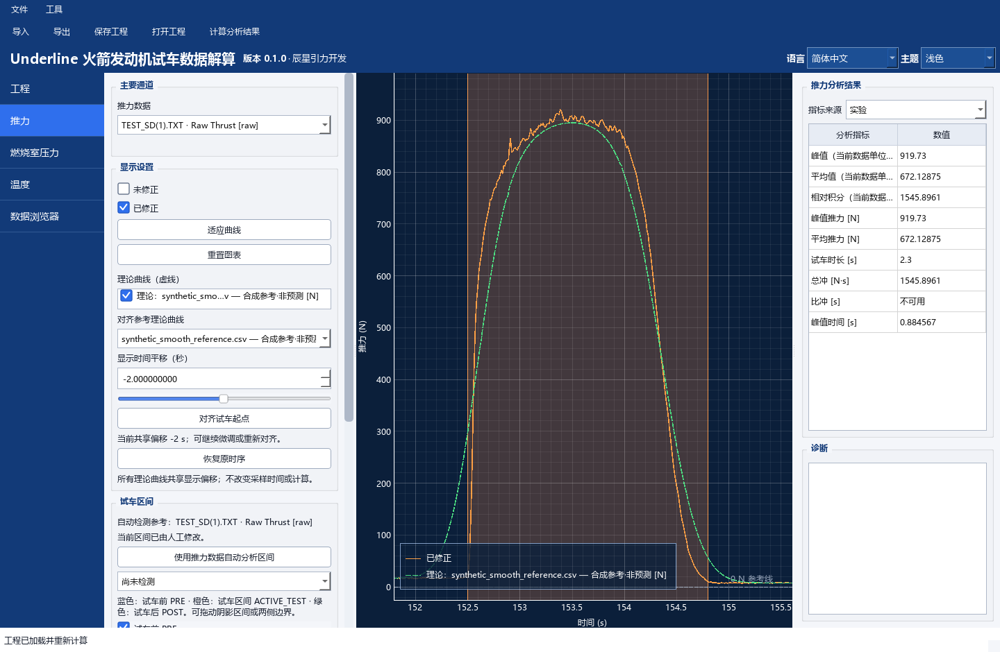
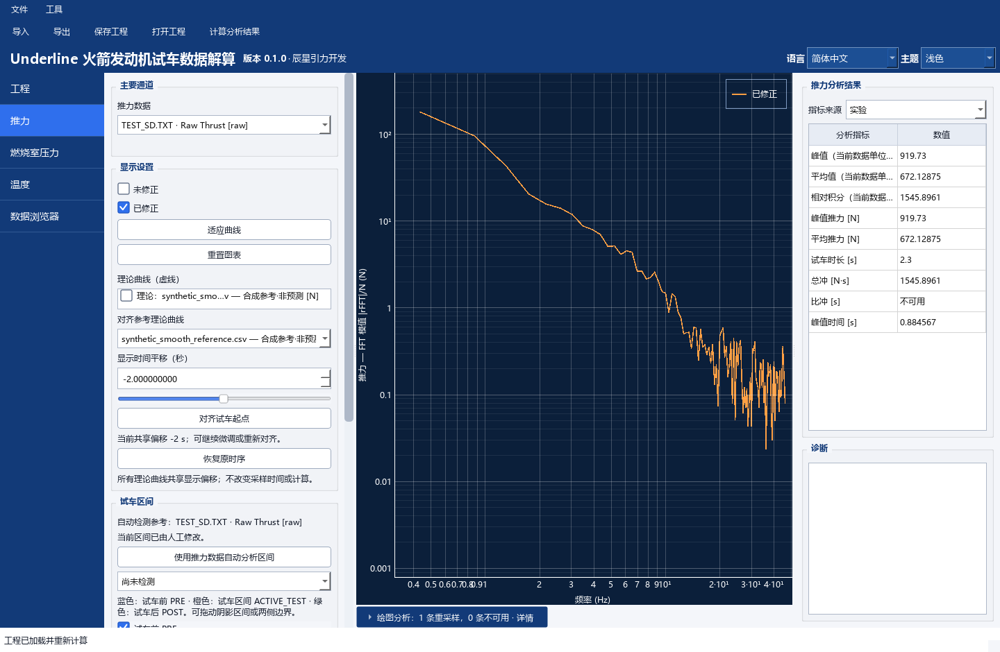

# Underline RETLDC

火箭发动机试车数据的离线解析、校准、分析与导出工具。
Offline rocket-engine test data decoding, calibration, analysis and export.

**[下载 Windows 便携版](https://github.com/aleistercrowleybeast666/Underline_RETLDC/releases/download/v0.1.0/Underline_RETLDC_0_1_0_Windows_Portable.zip)** · [三步体验](docs/Recorded_Data_Showcase.md) · [使用手册](README.txt) · [发布文章](https://www.kechuang.org/t/91966) · [English](#english-quick-start)

**实验记录与模拟参考放在一起看。** 橙线为用户提供的实验记录，绿虚线为用于演示的平滑模拟参考。



拖动滑动条或输入偏移秒数，就能平移参考曲线；也可以按两份数据的试车起点自动对齐，再手动微调。[查看平移前后对比](docs/Recorded_Data_Showcase.md#移动时间轴与对齐曲线)。

## 主要功能

- **导入与校准**：支持 TR_F / TR_P / TR_T、CSV / TSV / XLSX，通用表格可保存列映射预设。
- **曲线对照**：在推力、燃烧室压力、温度等时间图中叠加参考数据，平移、自动对齐并分别计算指标。
- **试车区间**：自动识别，也可拖动边界调整；切换全段或只看选定工作区间。
- **频谱分析**：用 FFT 查看频率成分，X/Y 轴均可切换对数坐标，观察不同量级的成分和局部峰值。
- **保存与导出**：保存工程和视图，导出实验 CSV、PNG、TXT / JSON 报告及满足输入条件的 ENG。
- **界面**：简体中文 / English、浅色 / 深色主题。



*真实 Qt 中文界面离屏截图。[完整操作与数据说明](docs/Recorded_Data_Showcase.md)；模拟参考用于演示，频谱峰值的物理原因需结合工况判断。目前提供截图，没有视频。*

## 下载与开始

当前稳定版 **v0.1.0 · 2026-10-15**。下载便携 ZIP，对照 [Release 正文](https://github.com/aleistercrowleybeast666/Underline_RETLDC/releases/tag/v0.1.0) 的 SHA-256 校验，完整解压后运行 `Underline_RETLDC.exe`，无需安装 Python。

**无硬件体验：** 按[示例指引](docs/Recorded_Data_Showcase.md)保存 TXT、参考 CSV 和工程 JSON → 从示例目录启动应用并打开工程 → 平移曲线、切换指标、查看 FFT 或导出结果。[下载示例文件](examples/record_showcase)。

Release 另附[对应源码包](https://github.com/aleistercrowleybeast666/Underline_RETLDC/releases/download/v0.1.0/Underline_RETLDC_0_1_0_Corresponding_Sources.zip)，包含第三方原始归档；校验值在 Release 正文，没有单独的 `SHA256SUMS.txt` 附件。

## English quick start

Download the [Windows portable ZIP](https://github.com/aleistercrowleybeast666/Underline_RETLDC/releases/tag/v0.1.0), verify its SHA-256, extract the whole folder and run `Underline_RETLDC.exe`. For a hardware-free tour, follow the [sample walkthrough](docs/Recorded_Data_Showcase.md#english-walkthrough).

Shift the reference curve with the slider or offset field, align test starts automatically, then fine-tune. Detect the test interval or drag its boundaries, switch metric sources, inspect FFT with linear or logarithmic axes, and export experimental results. The smooth reference is synthetic; sample processing details are recorded in the walkthrough. Screenshots are actual Qt offscreen renders.

## 文档与反馈

| 入口 | 内容 |
|---|---|
| [使用手册](README.txt) | 完整中文操作说明 |
| [记录与叠图示例](docs/Recorded_Data_Showcase.md) | 时间平移、FFT、独立计算、实验导出与数据说明 |
| [极简合成例](docs/Synthetic_Overlay_Example.md) | 两条短曲线与复现公式 |
| [来源与理论曲线](docs/Theoretical_Curves.md) | 来源、显示对齐和计算规则 |
| [数据格式](docs/Data_Formats.md) · [Plugin API v1](docs/Plugin_API.md) | 表格映射、工程格式与插件扩展 |
| [v0.1.0 更新说明](docs/Release_Notes_0_1_0.md) · [发布文章](https://www.kechuang.org/t/91966) | 版本功能介绍 |
| [GitHub Issues](https://github.com/aleistercrowleybeast666/Underline_RETLDC/issues) | 问题反馈，请附版本与复现步骤 |

源码运行需要 Python ≥ 3.11；已有 `.venv` 时直接复用，首次运行：

```powershell
python -m venv .venv
.\.venv\Scripts\python.exe -m pip install -e .
.\.venv\Scripts\python.exe main.py
```

开发前阅读 [AGENTS.md](AGENTS.md) 与 [TARGETS.md](TARGETS.md)。原创代码采用 [Apache-2.0](LICENSE)，第三方许可见 [THIRD_PARTY_NOTICES.txt](THIRD_PARTY_NOTICES.txt)。
