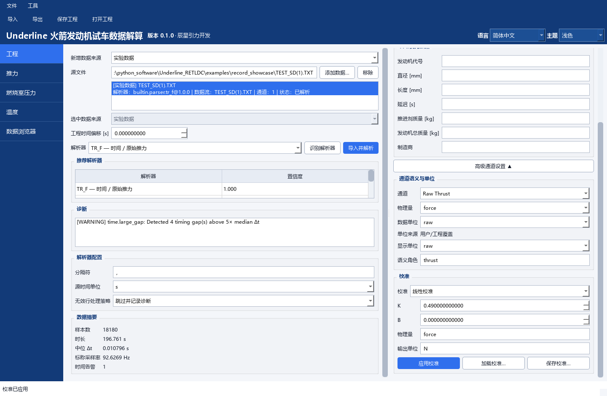
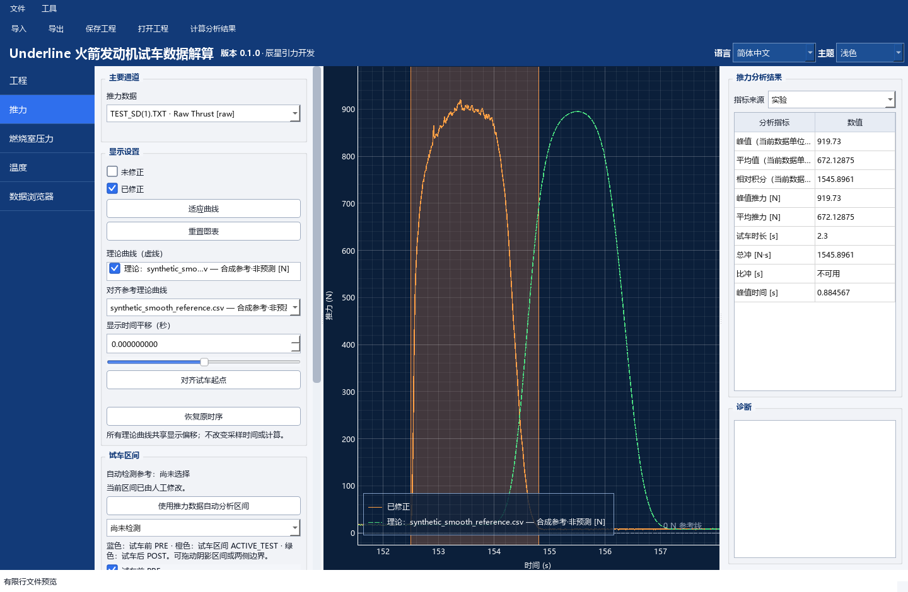
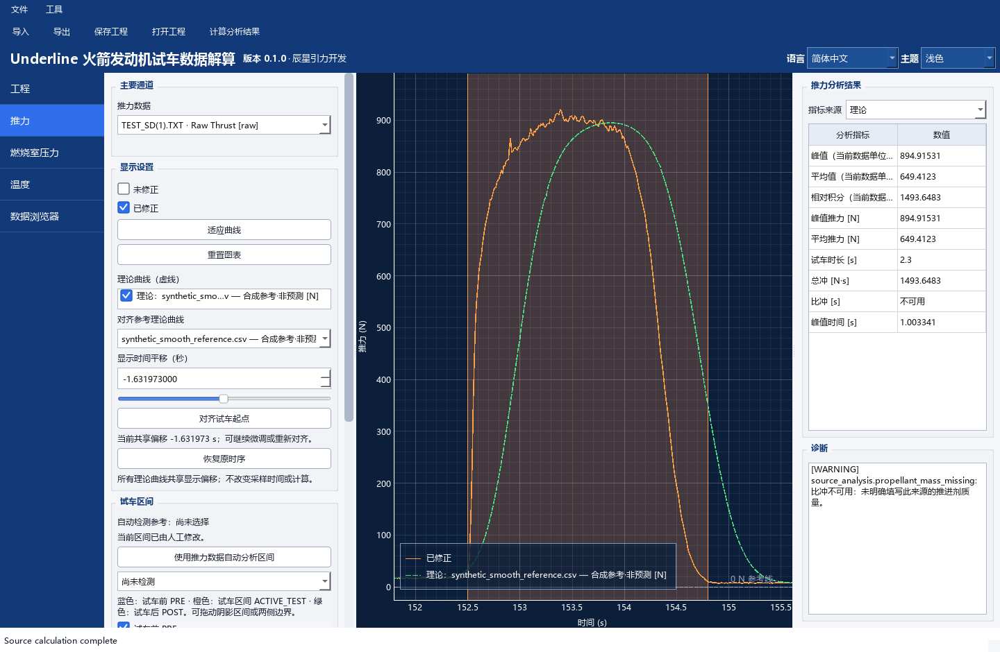
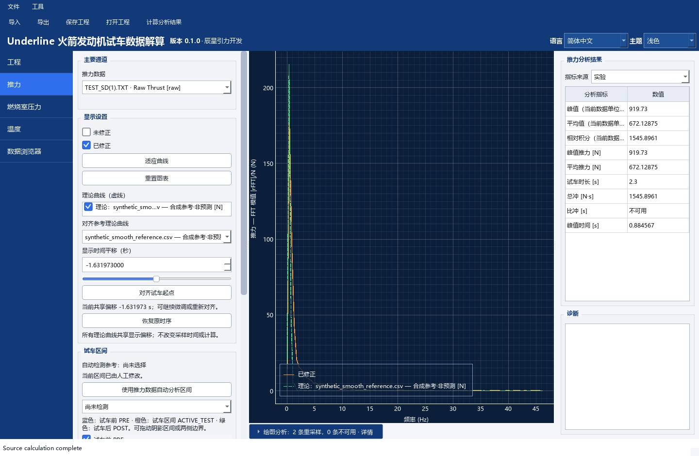
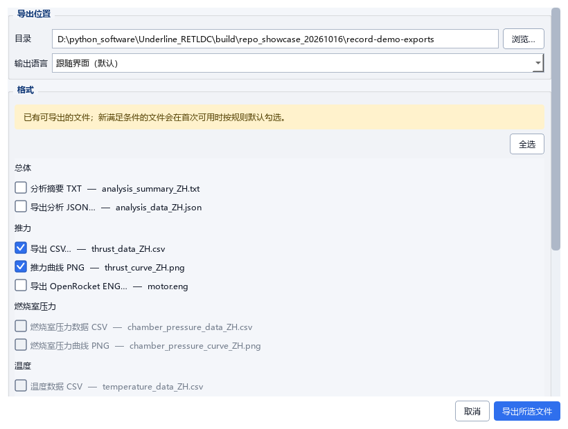

# 原始记录与平滑合成参考 / Recorded-data showcase

[返回首页](../README.md) · [完整手册](../README.txt) · [来源计算边界](Theoretical_Curves.md)

原始 `TEST_SD(1).TXT` 由数据提供者提供并授权本次公开展示：第一列为秒，第二列为原始值。**原文件和实验抖动保持不变。`0.49 N/raw` 仅根据提供者所述“最大推力大概 919.7 N”作展示估算；平滑参考由记录趋势生成，不是真实理论预测，不用于性能证明或工程推断。**

## 三步体验

1. 下载 v0.1.0 [Windows 便携包](https://github.com/aleistercrowleybeast666/Underline_RETLDC/releases/tag/v0.1.0)，完整解压。按 Release 正文核对 SHA-256。
2. 在自己的可写目录保存下面三份必需文件，保持文件名和同目录关系。在 GitHub 文件页使用 **Download raw file**；不必下载大型对应源码包。
3. **从该示例目录启动应用**，再用“文件 → 打开工程”打开 `record_showcase.retldc.json`，进入“推力”。这是 v0.1.0 非主来源相对路径的要求；不能只在任意已启动窗口里打开 JSON。

| 文件 | 用途 |
|---|---|
| [TEST_SD(1).TXT](../examples/record_showcase/TEST_SD%281%29.TXT) | 必需；原始两列记录，18180 点，未改写 |
| [synthetic_smooth_reference.csv](../examples/record_showcase/synthetic_smooth_reference.csv) | 必需；18180 点平滑合成参考，独立来源与合成时钟 |
| [record_showcase.retldc.json](../examples/record_showcase/record_showcase.retldc.json) | 必需；已保存映射、估算换算、区间、显示对齐与两类完成状态 |
| [peak_estimate.calibration.json](../examples/record_showcase/peak_estimate.calibration.json) | 可选；显式记录估算系数与局限，供手动导入复现 |
| [generate_reference.py](../examples/record_showcase/generate_reference.py) | 可选；固定方法重建参考，使用仓库已有 NumPy/SciPy 环境 |

PowerShell 示例，将 EXE 路径替换为实际位置：

```powershell
Set-Location 'D:\MyExamples\record_showcase'
& 'D:\Tools\Underline_RETLDC\Underline_RETLDC.exe'
```

源码用户同样从示例目录，用仓库已有 `.venv\Scripts\python.exe` 执行仓库 `main.py`。无需另建环境。重开会校验源文件哈希并按保存配置重算已完成结果；不要编辑原始文件来绕过校验。

## 估算比例和零点处理

原始最大值为 `1877 raw`，出现在 `153.384567 s`。`919.7 / 1877 ≈ 0.489984`，本例按用户同意的整比例使用：

```text
F_est = 0.49 × raw + 0 N
推力极性 = +1；修正 = 不启用
```

这使显示峰值为 `919.73 N`，**不能反推证明设备采用 50 克力/单位或已有真实标定**。软件的“校准/已修正”是既有工作流名称，不构成对该系数的认证。

本例不做去皮或基线扣除。选定 PRE `[145,151] s` 的中位数为 `34 raw`（估算 `16.66 N`），POST `[160,170] s` 为 `19 raw`（估算 `9.31 N`）。这些偏置保留在曲线和积分中；不能把其差值当作推进剂消耗，也不能把图中数值视作已去零净推力。没有填入推进剂质量、总质量、直径或长度，比冲保持“不可用”。



## 对齐与分别计算

工程的实验 ACTIVE_TEST 为演示选定的 `[152.50,154.80] s`，PRE/POST 如上；可在原试车区间控件修改。它不是对真实燃烧起止的认证。原文件仍保留完整 `3.114664–199.875595 s` 记录。

合成参考把原时间列加 `2 s`，只为演示独立时钟。其计算区间明确保存为 `[154.50,156.80] s`，与实验使用同一原记录窗口；它不继承实验分段。新建理论来源默认用完整记录，不能把手动重建后的全段结果直接与这里的区间结果比较。



点击“对齐试车起点”使用当前实验手动起点和参考独立检测起点，本次得到 `-1.631973 s`。它不必等于人为时钟差的 `-2 s`，因为参考已被平滑且检测方法按活动阈值找起点。重复点击不累加；可继续手动微调或“恢复原时序”。**显示对齐不是拟合，不改变科学时间、区间、数组或积分。**


在结果区切换“实验 / 理论”，使用同一个顶部“计算分析结果”按钮。两类计算读取同一工程物理参数；本例这些参数均缺失，不借演示名义填入质量。理论的下拉名称只是软件来源角色，其通道名也标注“合成参考·非预测”。



| 演示估算量 | 原记录估算 | 平滑合成参考 |
|---|---:|---:|
| 所选区间时长 / s | 2.30 | 2.30 |
| 峰值 / N | 919.73 | 894.915307 |
| 区间梯形积分 / N·s | 1545.896136 | 1493.648280 |
| 比冲 | 不可用 | 不可用 |

数值差来自合成平滑方法与采样积分，不能用来证明发动机性能、理论一致性或模型误差。

## 工作区间 FFT 与实验导出

图表菜单中打开“仅分析工作区间”、FFT 和“去均值”，即可得到下图。退出 FFT / 关闭区间开关可恢复时域与全段。原记录全段有 4 个超过 `5×中位 Δt` 的时间空档；有限递增非等间隔时钟仍按 pyqtgraph 既有规则做等点数线性插值后 FFT，不能把插值视为新增实测信息。



纵轴是 `abs(rFFT(y)/N)` 模值，不是 PSD 或补乘 2 的单边幅值。频谱不证明共振、发动机稳定性或振动原因；平滑合成参考也不能验证这些结论。

顶部“导出”仍用实验主流程，即使结果区当前选择“理论”。本次实际输出并核对了 `thrust_data_ZH.csv` 和 `thrust_curve_ZH.png`；CSV 的 213 行逐点对应原区间内的 `0.49 × raw`，没有被参考曲线替换。导出时间以 `152.50 s` 为零点，首个保留样本约在 `0.009841 s`，不补造零时刻样本。正式 PNG 不含合成叠图；保存当前叠图请用图表右键 Export。



本例不演示 ENG → OpenRocket 导入，兼容演示尚未验证。缺少相应元数据，不为此补造参数。

## 参考生成方法与来源核验

对原始第二列创建一个新数组：先做 **31 点中值滤波**，再做 **高斯平滑 `sigma=20` 点、`truncate=4`、边界 `nearest`**，最后乘 `0.49`。参数按点数定义；它是趋势派生的合成曲线，不是独立理论模型。原时间列仅在合成文件中加 `2 s`；不重采样或改写实测数组，输出保留六位小数。

在示例目录运行仓库 venv 的 Python 执行 `generate_reference.py` 可重建；脚本先核验原始哈希，避免把别的文件当成本例。
原始 TXT 和合成 CSV 按固定原字节保存，示例目录的 Git 属性保护它们不被自动转换行尾。

| 文件 | SHA-256 |
|---|---|
| 原始 TXT | `7325935683d8380681a804c338b8fe8ebbe1539d5dc3211cc55743303c038e8f` |
| 平滑合成参考 CSV | `f51da844814ad9562415522a3fce113d3098af742220ee4afcf8ed7e73140a27` |

截图使用与 v0.1.0 标签一致的未修改源码、现有 venv 和真实 Qt 控件离屏渲染，加载本机中文字体；没有拼造界面、捕获私人桌面或制作桌面录屏。当前提供六张截图，没有视频。此次验证了来源哈希、数组保持、对齐不累加、显示平移不改指标、独立结果、正式实验导出和工程重开；不等于全量测试通过，历史 Windows 原生堆异常仍未归因。

## English walkthrough

Download the three required TXT/CSV/project files together. Launch v0.1.0 **with their folder as the working directory**, then open `record_showcase.retldc.json`. The original record has seconds and raw sensor values. The user supplied an approximate 919.7 N peak; `0.49 N/raw`, offset zero and positive polarity are explicitly an illustrative peak-based estimate, not verified sensor calibration. Baseline offsets remain; no weight correction or propellant mass is invented. Isp stays unavailable.

The smooth reference is derived from a new array using a 31-sample median filter followed by a Gaussian with sigma 20 samples, nearest boundaries and truncate 4. Its clock is shifted by +2 s. It is synthetic, not an independent physical prediction, performance proof or engineering inference. Use Align Test Starts, switch metric sources and Calculate, inspect active-interval FFT, or export the experimental CSV/PNG. Display alignment never changes scientific inputs. Screenshots are actual Qt offscreen renders; there is no desktop recording or verified OpenRocket import demonstration.
