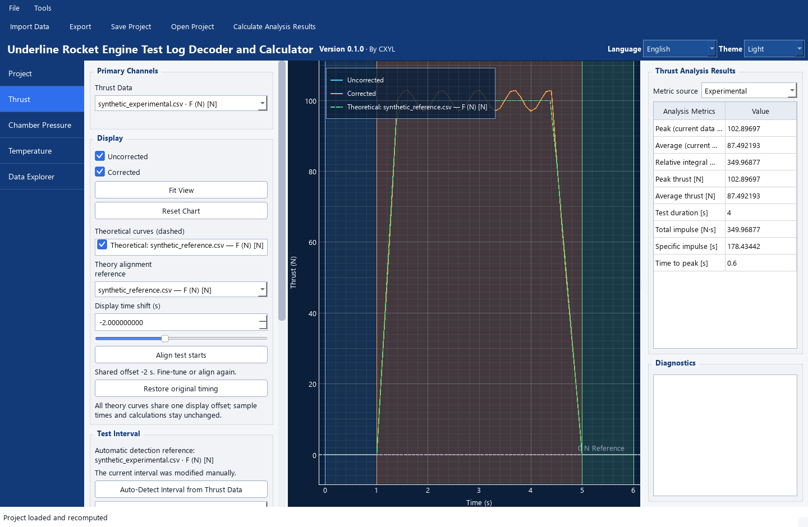

# 无硬件叠图示例 / Synthetic overlay example

[返回首页](../README.md) · [完整手册](../README.txt) · [来源计算说明](Theoretical_Curves.md)

**两条曲线都是本次新建的合成教学数据，不是实测，也不是物理模型的理论预测。**
`experimental` / `theoretical` 只是本例用于演示的来源角色。平滑参考曲线由下述函数直接生成，没有从实测数据拟合或平滑得到。

本例适用于已发布的 v0.1.0。示例和截图是发布后补充的仓库展示文件，旧便携包不含它们。没有复制第三方或权限未明的试车记录；新增 CSV、工程与界面截图随仓库 Apache-2.0 许可提供，第三方界面组件仍适用各自许可。

## 文件

下载或复制[整个示例文件夹](../examples/synthetic_overlay)，保持以下三份文件在同一目录：

在 GitHub 可逐个打开下列文件链接，使用文件页的 **Download raw file** 保存，保持原文件名；无需下载大型对应源码包。

| 文件 | 含义 |
|---|---|
| [synthetic_experimental.csv](../examples/synthetic_overlay/synthetic_experimental.csv) | 61 点，0–6 s，步长 0.1 s；合成起伏曲线，作为实验角色导入 |
| [synthetic_reference.csv](../examples/synthetic_overlay/synthetic_reference.csv) | 49 点，2–8 s，步长 0.125 s；平滑合成参考，作为理论角色导入 |
| [synthetic_overlay.retldc.json](../examples/synthetic_overlay/synthetic_overlay.retldc.json) | 由 v0.1.0 实际 GUI 保存的完整例子；含列映射、来源哈希、区间、完成状态与独立结果 |

CSV 只含 `Time (s),F (N)`，UTF-8、逗号分隔，第一行表头、第二行开始数据。文件名及本指引明确标注合成来源。

## 路线一：手动导入，了解每个步骤

1. 正常启动 v0.1.0，在“工程”新建空工程，来源选择“实验数据”，导入 `synthetic_experimental.csv`。
2. 使用通用 CSV / TSV 解析器，核对第 1 列为 **Time / s**，第 2 列为 **Thrust / N**。必要时展开高级映射：时间索引 0；数据索引 1，quantity `force`、role `thrust`。按实际预览确认后解析。
3. 确认实验主推力来自该文件，校准保持 Identity，推力极性 +1，修正“不启用”。本例的 N 是预先定义的合成工程单位，Identity 不表示实物传感器经过标定。
4. 设 PRE 为 `[0,1]` s、ACTIVE_TEST 为 `[1,5]` s、POST 为 `[5,6]` s。也可先自动检测再手动改为这些演示区间。工程推进剂质量填 `0.2 kg`，它只是教学输入，不代表实际发动机。
5. 在“工程”把新来源改成“理论数据”，加入 `synthetic_reference.csv`，使用同一列映射。不要让它替代实验主推力。
6. 在推力页勾选理论曲线，将“显示时间平移”设为 `-2 s`。该数值是本例人为设置的时钟差；“对齐试车起点”会使用检测结果，未必恰好等于 -2 s。
7. 用顶部“计算分析结果”计算实验指标；在结果区“指标来源”切到理论后再用同一按钮计算。理论默认使用完整科学记录 `[2,8]` s；它不继承实验 `[1,5]` s 的区间。两个平均值的时间分母不同，不能当作同区间比较。
8. 保存到自己的工程文件。顶部统一导出使用实验主流程；要保留虚线参考与显示平移，使用图表右键 Export 的当前图 PNG / SVG 路径。本例没有填写 ENG 所需的完整发动机元数据，不能直接演示 ENG；ENG → OpenRocket 实际导入兼容演示留待后续验证，不补造参数。

参考积分结果：实验 `[1,5]` s 总冲约 **349.968773 N·s**，参考完整 `[2,8]` s 总冲约 **349.479167 N·s**。这些只是六位小数 CSV 采样点的梯形积分，不是发动机性能结论。缺有效推进剂质量时 Isp 应保持不可用。

## 路线二：打开已完成工程

v0.1.0 的非主来源相对路径按**启动工作目录**查找。打开本例前，应在示例文件夹中启动应用，不能只在任意已打开窗口中直接打开 JSON。

Windows PowerShell 示例；将 EXE 路径换成自己的实际解压位置：

```powershell
Set-Location 'D:\MyExamples\synthetic_overlay'
& 'D:\Tools\Underline_RETLDC\Underline_RETLDC.exe'
```

然后使用“文件 → 打开工程”选择该目录下的 `synthetic_overlay.retldc.json`，进入推力页。源码用户可从该目录用仓库已有 `.venv\Scripts\python.exe` 执行仓库的 `main.py`；不要另建环境。也可随时采用路线一，按绝对路径重新导入 CSV 后保存自己的工程。

工程已保存两类来源的完成状态；重开会从校验通过的 CSV 和保存的配置重算结果。显示平移 -2 s 不改变理论的 2–8 s 科学时间、原始数组或积分。不要编辑 CSV 后绕过哈希检查。



## 数据出处与复现

本例原创生成于 2026-10-16，没有外部数据输入。令 `u` 为从 0 开始的教学时间，定义：

```text
E(u) = max(0, min((u - 1) / 0.4, 1, (5 - u) / 0.6))
实验角色：t = u = 0, 0.1, …, 6；F = 100 E(u) [1 + 0.03 sin(9u)] N
参考角色：u = 0, 0.125, …, 6；t = u + 2；F = 100 E(u) N
```

三位小数时间与六位小数推力直接写入 CSV；无随机种子、平滑、重采样或隐藏实测输入。不同采样步长使离散梯形积分略有不同。

| CSV | SHA-256 |
|---|---|
| synthetic_experimental.csv | `25312d95cc5a500d3ba892b4423b0c4a8b0965308d9459f130870bb0f99856db` |
| synthetic_reference.csv | `111ce04ea578c3e2fc7c761b39da91da4aef1e6b7bdd2380aa45cb28d62c8219` |

## English walkthrough

Both curves are invented teaching data. The smooth reference is generated directly from a piecewise linear envelope; it is neither a measurement nor a physical simulation prediction. Source kinds are demonstration import roles.

Download all three files in [examples/synthetic_overlay](../examples/synthetic_overlay). For the saved project, launch v0.1.0 **with that folder as the working directory**, then open `synthetic_overlay.retldc.json`. This is required by v0.1.0's handling of secondary relative source paths. Alternatively import each CSV manually with Generic CSV / TSV: column 0 = Time in seconds, column 1 = Thrust in newtons; choose Experimental for the first file and Theoretical for the reference.

Use +1 polarity, Identity calibration and no correction. The demonstration Project propellant mass is 0.2 kg. The experimental ACTIVE_TEST is 1–5 s; the theory calculation uses its independent full 2–8 s record. Set the shared theory display shift to -2 s, and calculate each source using the toolbar action and metric-source selector. Display shifts never change scientific timestamps or integrals. Unified exports use the experimental workflow; use the plot's context-menu image export for the visible overlay.

This example omits the complete motor metadata required for ENG export. An actual ENG import demonstration in OpenRocket remains a follow-up; no compatibility validation is claimed.
